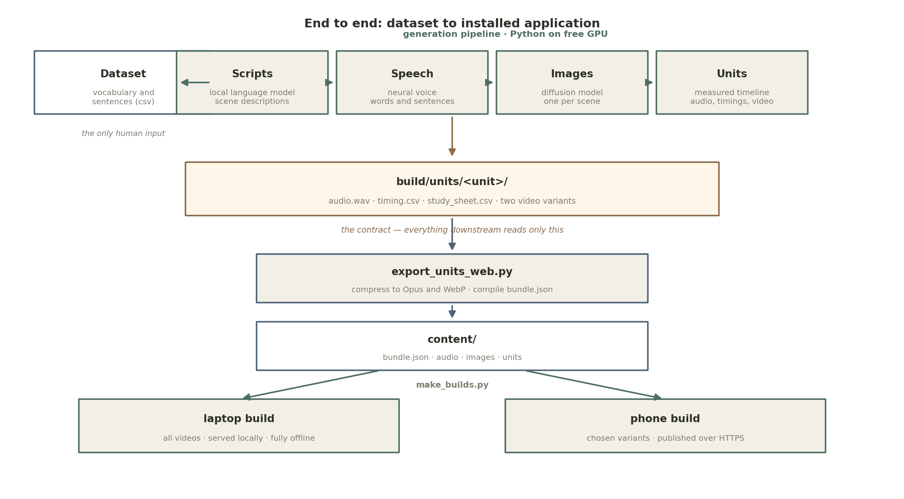
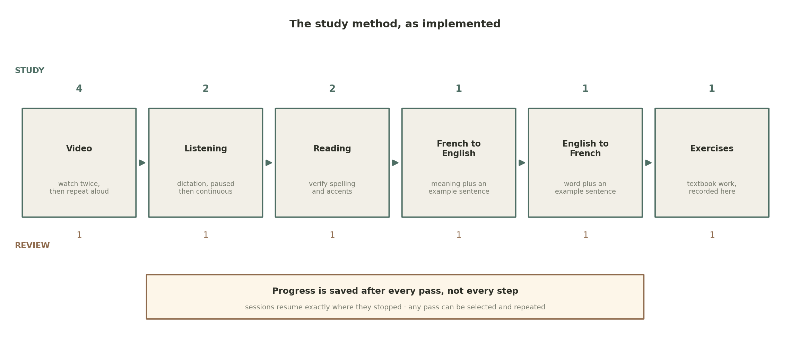
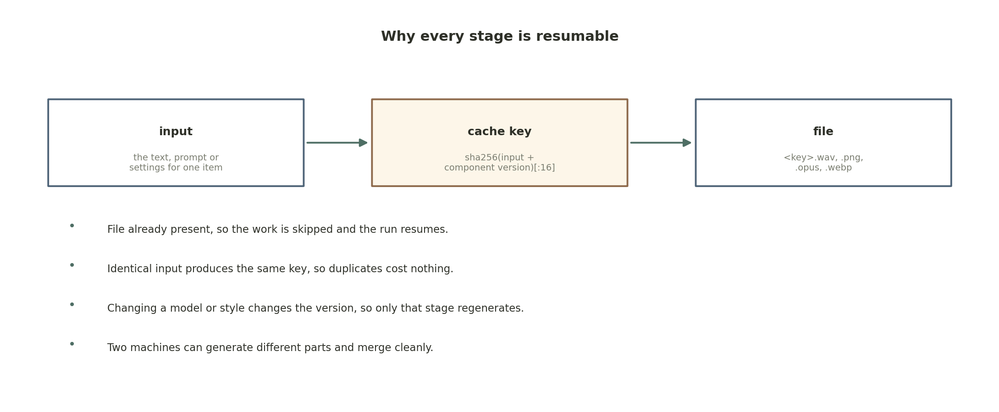
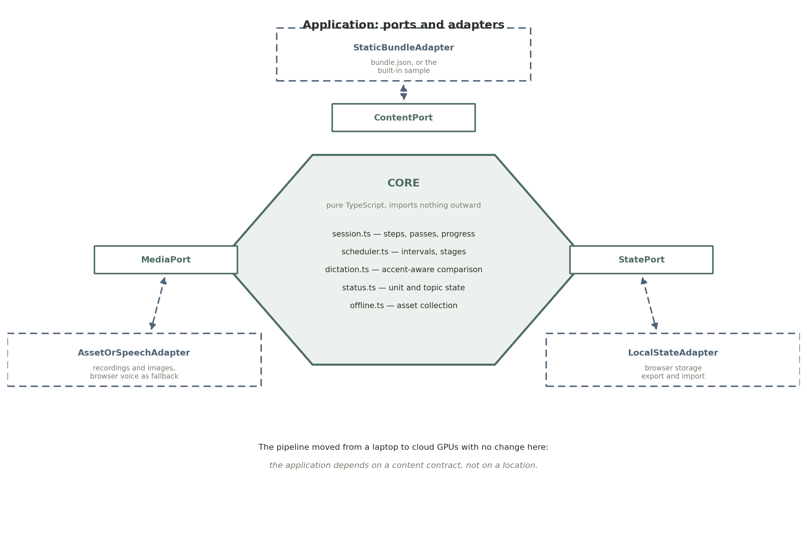
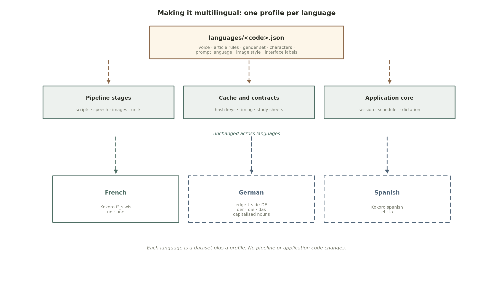

<div align="center">

# Language Acquisition System

**Turn a vocabulary spreadsheet into a complete, offline language-study app.**

Illustrated sentences · spoken recordings · measured practice audio · unit videos · a phone-installable study app


**French: finished · German: in production**

[**Open the German app →**](https://learning-german-platform.netlify.app)

</div>

<br>



---

## Contents

- [What it is](#what-it-is)
- [What it produces](#what-it-produces)
- [The learning method](#the-learning-method)
- [How it works](#how-it-works)
- [Quick start](#quick-start)
- [Repository layout](#repository-layout)
- [Adding a language](#adding-a-language)
- [Design principles](#design-principles)
- [Operating notes](#operating-notes)
- [Roadmap](#roadmap)
- [Documentation](#documentation)

---

## What it is

Two halves that meet at a file contract.

| Half | Written in | Job |
|---|---|---|
| **Generation pipeline** | Python | Turns a vocabulary spreadsheet into finished study material, on free cloud GPUs |
| **Study application** | React + TypeScript | Walks the learner through a fixed six-step method, checks written dictation, schedules review, works with no network, and installs on a phone |

Neither half knows how the other works. The pipeline writes files into a defined structure, and the app reads a compiled bundle derived from them. That separation is why the pipeline could move from a laptop to cloud GPUs without a single change to the app.

### The problem it addresses

- **Words without context.** Every word appears in three sentences at different registers, so it is learned as usage, not as a translation pair.
- **Recognition without production.** Written and spoken output is required before a word counts as known.
- **Material that cannot be reshaped.** Because the media is generated, it matches the method exactly: pauses measured for repetition, a translation-free video variant, per-unit practice audio.

> **A constraint held throughout: no recurring cost.** Free cloud GPUs, free static hosting, storage on the device. Nothing to renew, and nothing that stops working if a subscription lapses.

---

## What it produces

Figures from the finished French dataset:

| Artefact | Quantity | Purpose |
|---|---:|---|
| Vocabulary recordings | 590 | One per word, spoken in natural citation form |
| Sentence recordings | 1,770 | Three registers for every word |
| Illustrations | 1,768 | One per scene, deduplicated by content |
| Study units | 129 | Five words each, one sitting |
| Unit videos | 258 | Two variants: with translation, and target language only |
| Practice tracks | 129 | Measured audio with pauses timed for repetition |

---

## The learning method

Every unit follows the same six steps. Pass counts for study sessions are shown above each step in the figure, and for review sessions below it.



| Step | Passes | What happens |
|---|:---:|---|
| **Video** | 4 | Two passes watching and listening only. On the third and fourth the video pauses after each line so the learner repeats it aloud. |
| **Listening** | 2 | Dictation, first with pauses, then continuously. Answers are compared against the source automatically. |
| **Reading** | 2 | Spelling and accents verified against what was written during dictation. |
| **Target → native** | 1 | Write the meaning and a full example sentence in the target language. |
| **Native → target** | 1 | Write the word and a full example sentence. |
| **Exercises** | 1 | Textbook work, recorded in the app with a reference and notes. |

**Review sessions** run the same six steps once each. The video step becomes shadowing (speaking along without stopping) and recall becomes self-testing.

**Scheduling.** Recall answers are graded on four levels. Each word carries an interval, an ease factor, a repetition count and a lapse count, and moves through four stages: *not started → learning → consolidating → established*. Review is always offered before new material. Progress is saved after every pass, so a session resumes exactly where it stopped.

---

## How it works

### The pipeline

A validation gate runs first; nothing proceeds until the dataset passes. Then each stage writes into a shared cache.

| # | Stage | Script | Engine |
|:-:|---|---|---|
| 1 | Dataset check | `validate.py` | pandas + Pandera |
| 2 | Scene descriptions | `generate_scripts.py` | Local language model (Ollama, `llama3.1:8b`) |
| 3 | Sentence recordings | `make_audio.py` | Neural text to speech (Piper for German, Kokoro for French) |
| 4 | Word recordings | `make_vocab_audio.py` | Same voice |
| 5 | Illustrations | `make_images.py` | Diffusion model |
| 6 | Study units | `build_units.py` | ffmpeg audio assembly + Pillow frame rendering |
| 7 | Web content | `export_units_web.py` | Compresses to Opus and WebP, compiles `bundle.json` |
| 8 | Builds | `make_builds.py` | Laptop build and phone build |
| 9 | Publish | `publish.py` | Phone build to Netlify |

The units stage is the substantial one. It assembles a continuous audio track for each unit, **measuring the real duration of every segment**, then writes a timing table and renders video against it. Those same measured timings later drive the app's guided pauses.

### Why every stage is resumable



Each artefact is named by a **hash of its input plus a component version string**. This single decision gives:

- **Resumability.** Run it again and finished work is skipped.
- **Safe engine swaps.** Change a version string and only that stage regenerates.
- **Conflict-free merging.** Output generated on different machines or sessions combines by copying folders together.
- **Deduplication.** Identical scenes produce one illustration.

### The application



The core holds all learning logic and imports nothing outward. Everything it needs comes through three ports:

| Port | Responsibility | Current implementation |
|---|---|---|
| **Content** | Units, words, sentences, segment timings | Static bundle, with a built-in sample as fallback |
| **Media** | Resolve and play audio, images and video | Generated assets when present, browser speech otherwise |
| **State** | Review schedule, session progress, settings | Browser storage, with export and import |

Two consequences: the app runs with **no content at all** (so it is testable and demonstrable), and missing assets degrade **one item at a time** instead of breaking a screen.

**Offline by design.** A service worker serves the page and `bundle.json` network-first (so a redeploy is picked up), and hashed assets and media cache-first. It also answers byte-range requests from stored files, so video plays from the device.

### Technology

| Area | Choices |
|---|---|
| Pipeline | Python · pandas · Pandera · Pydantic · Pillow · ffmpeg |
| Generative models | Local language model · neural text to speech · diffusion model |
| Application | React 18 · TypeScript · Vite. No runtime dependencies beyond React: the scheduler, dictation comparison and session machine are written directly. About 65 KB compressed. |
| Delivery | Static files. Local server for the full version, static host for the published version |
| Storage | Cloud drive for the project and masters · browser cache for media · browser storage for progress |

---

## Quick start

### Produce a language (Google Colab, recommended)

1. Put `language_system_production.zip` in **My Drive** (or `My Drive/language_system`).
2. Open `notebooks/00_production.ipynb` in Colab and choose **Runtime → Change runtime type → T4 GPU**.
3. **Runtime → Run all.** The last cell prints a link and a sign-in. Open it and keep the tab open while the page works.
4. Choose the language and press **Start**.

Everything is written to `My Drive/language_system`. If the session disconnects, run all again and press Start: finished work is skipped.

**Optional secrets** (key icon in Colab, then *Notebook access* on):

| Secret | Needed for |
|---|---|
| `NETLIFY_AUTH_TOKEN` | The Publish option. Everything else works without it. |
| `PANEL_PASSWORD` | A fixed panel password. Otherwise a random one is printed each run. |

### Command line

```bash
python bin/status.py --lang de        # where does this language stand?
python bin/produce.py --lang de       # run every stage, skipping finished work
python bin/publish.py --lang de --dry-run   # preview what would be published
```

Every command accepts `--lang <code>`. Every stage is resumable.

### Run the app locally

```bash
cd app
npm install
npm run dev        # development server
npm run build      # type-check, then production build
```

Requires Node 18 or newer. All dependency versions are pinned exactly.

---

## Repository layout

```
bin/            every command; bin/produce.py runs them all in order
languages/      one profile per language: fr.json, de.json
data/<code>/    vocab.csv and sentences.csv, the only human input
app/            the study application (React + TypeScript + Vite)
notebooks/      00_production.ipynb, the production page on Colab
docs/           PRODUCTION.md, LANGUAGES.md, the full system reference
```

Generated material (recordings, illustrations, videos, builds) is **not stored in this repository**. It lives in Google Drive and is regenerated from the dataset and scripts.

---

## Adding a language

Most of the system is already language-neutral: the dataset schema carries a language column, the pipeline stages are generic, and the app core has no language knowledge. What varies lives in a **language profile**, one file per language.



| What varies | Why |
|---|---|
| Voice model and voice name | Each language needs its own voice |
| Citation form | German nouns are spoken with their article (*der Hund*, *die Katze*, *das Haus*) |
| Gender values | French has two, German three, many languages none |
| Special characters | The on-screen keyboard aid must offer ä ö ü ß |
| Comparison rules | ß and *ss* accepted as equal in lenient checking |
| Prompt language and image style | The model is told which language and cultural setting to write for |
| Interface wording | Step names and greeting |

**To add a language:** supply a dataset (`data/<code>/`) and a profile (`languages/<code>.json`). No pipeline or app code changes, and existing languages are unaffected because every artefact is keyed by content. Start with a trial set of about twenty words and compare one unit against its French equivalent before committing to a full dataset. See [`docs/LANGUAGES.md`](docs/LANGUAGES.md).

---

## Design principles

- **No server.** The app is static files: no backend, no database, nothing that can go down.
- **No dependence on a host.** Moving the published copy is a folder upload. The local copy needs nothing at all.
- **Offline after download.** Study works entirely offline, with progress stored on the device.
- **Smallest thing that works.** Infrastructure is added only after asking what specifically is failing.
- **Publish the generator, not the output.** Anyone can supply their own dataset and profile and produce their own material.

---

## Operating notes

**What to protect.** Recordings, illustrations and videos can all be regenerated. The **scene descriptions and unit scripts cannot**: the language model is not deterministic, so regenerating them produces different output. Keep them backed up outside the working drive. Learning progress lives on the device; use **Export** in preferences occasionally to guard against a cleared browser.

**Rules that prevent recurring problems**

- Keep the app folder free of anything except app files and the content folder. The build script copies everything else into both outputs.
- Direct build output outside the app folder.
- Pin dependency versions exactly.
- Trust the version strings that scripts print and the app displays, rather than assuming which code is running.
- **Never open the dataset CSVs in a spreadsheet application.** The encoding does not survive.

---

## Roadmap

| Feature | Shape |
|---|---|
| Speaking practice | Short prompt videos, no pausing and no correct answer; recording through a recorder port, reviewed by the learner rather than scored |
| Exercise content | Structured items behind an exercise port, loaded from a local folder and never published |
| Generated practice | Gap-fill exercises derived from sentences already owned |
| Cross-device progress | Only if per-device progress becomes a real annoyance; export and import already cover transfer |

Next steps are driven by use, not by a feature list written in advance: which steps get skipped, whether dictation accuracy improves, and whether review actually happens daily.

---

## Documentation

| Document | Contents |
|---|---|
| [`docs/Language_System_Reference.docx`](docs/Language_System_Reference.docx) | The full system reference: method, architecture, extension guide |
| [`docs/PRODUCTION.md`](docs/PRODUCTION.md) | Step-by-step production guide |
| [`docs/LANGUAGES.md`](docs/LANGUAGES.md) | How a language is described |

---

<div align="center">

*Figures show the French build. The system is language-neutral.*

</div>
